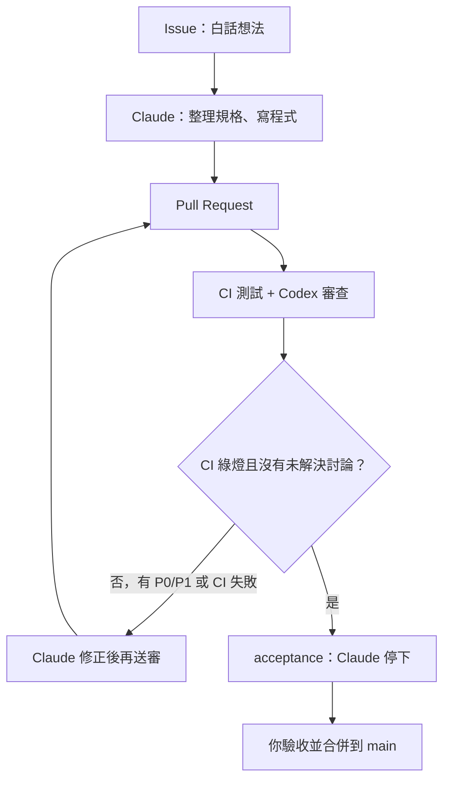

# claude-codex-lab

你用白話寫 GitHub Issue，Claude 寫程式並開 PR，Codex 只做審查，GitHub Actions 跑測試。CI 通過、審查討論都解決之後，Claude 停下等你驗收，由你合併到 `main`。

沒有人可以直接推上 `main`。

## 流程

1. 你開 Issue，用日常語言寫想法（表單會自動標上 `proposed`）。
2. Claude 把想法整理成規格與驗收條件。太大就拆成子 Issue。你確認後標成 `ready`（很小的修改 Claude 可以自己接著做）。
3. Claude 標成 `in-progress`，在 `claude/issue-<編號>-<簡稱>` 上實作，一個 Issue 開一張 PR。
4. CI 跑 `scripts/test.sh`，Codex 只提出嚴重問題（P0／P1）。
5. 有問題的話，Claude 修正、回覆並解決討論、再請審查。這段會重複到 CI 綠燈且沒有未解決的討論。
6. Claude 標上 `acceptance` 然後停下。你照 PR 裡的驗收步驟看過，滿意再合併。

規格不清楚、需要金鑰、會花錢、會刪資料，或牽涉安全決策時，Claude 會標 `needs-human` 並停下來問你。

## 標籤

| 標籤 | 意思 |
| --- | --- |
| `proposed` | 新想法，等 Claude 整理成規格 |
| `ready` | 規格確定，Claude 可以開始做 |
| `in-progress` | Claude 正在做或正在修 |
| `needs-human` | 需要你決定，AI 先停 |
| `acceptance` | 可以驗收了，等你合併 |
| `blocked` | 被其他 Issue 或外部因素卡住 |
| `P0` | 審查：嚴重問題（安全、資料遺失、壞掉、祕密進版控） |
| `P1` | 審查：明確的功能錯誤 |

規則全文在 [AGENTS.md](AGENTS.md)（英文，給 AI）。Claude 的操作步驟在 [CLAUDE.md](CLAUDE.md)。
