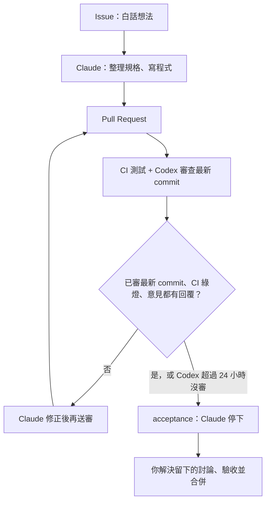

# claude-codex-lab

你用白話寫 GitHub Issue。Claude 每 4 小時做一件事：整理規格，或實作最舊的一個 `ready`。Codex 只做審查，GitHub Actions 跑測試。Codex 審過最新的 commit、CI 通過、意見都有回覆之後，Claude 停下等你驗收，由你合併到 `main`。

沒有人可以直接推上 `main`。

## 流程

1. 你開 Issue，用日常語言寫想法（表單會自動標上 `proposed`）。
2. Claude 把想法整理成規格與驗收條件。太大就拆成子 Issue，並請你加上 `ready`。這一步還不寫程式。
3. 你加上 `ready` 之後，若沒有尚未驗收的 PR，Claude 只做最舊的一個：拿掉 `ready`、標成 `in-progress`，在 `claude/issue-<編號>-<簡稱>` 上實作，開一張 PR。語言和框架由 Claude 決定，寫在 `docs/decisions/`。
4. CI 跑 `scripts/test.sh`，Codex 只提出嚴重問題（P0／P1）。
5. 有問題的話，Claude 修正並在該討論回覆 `[claude-fixed]`（Action 會把討論標成已解決）或 `[claude-declined]`（討論留著等你決定），再貼一次 `@codex review`。
6. Codex 已經審查最新的 commit、CI 綠燈、每則意見都有回覆之後，Claude 標上 `acceptance` 然後停下。超過 24 小時 Codex 仍沒審該 commit 時也會停下，並註明要你自己看那個 diff。你照驗收步驟看過，把還開著的討論解決，再合併。

產品方向不清楚、需要金鑰、會花錢、會刪資料、牽涉安全決策、同一種 CI 失敗修了三次，或不同意某個 P0 時，Claude 會標 `needs-human` 並停下來問你。技術選型不會問你。

## 標籤

| 標籤 | 意思 |
| --- | --- |
| `proposed` | 新想法，等 Claude 整理成規格 |
| `ready` | 規格確定，Claude 可以開始做 |
| `in-progress` | Claude 正在做或正在修 |
| `needs-human` | 需要你決定，AI 先停 |
| `acceptance` | 可以驗收了，等你合併 |
| `blocked` | 被其他 Issue 或外部因素卡住 |
| `P0` | 審查：嚴重問題（安全、資料遺失、壞掉、祕密進版控） |
| `P1` | 審查：明確的功能錯誤 |

規則全文在 [AGENTS.md](AGENTS.md)（英文，給 AI）。Claude 的操作步驟在 [CLAUDE.md](CLAUDE.md)。設定 Claude 排程與 Codex 審查見 [docs/SETUP.md](docs/SETUP.md)。

## 旅行照片整理（#5：匯入與排序）

在自己的電腦上用瀏覽器操作，照片不會上傳，原始檔案不會被修改。

### 啟動

1. 安裝 Python 3.10 以上版本（<https://www.python.org/downloads/>；Windows 安裝時勾選「Add python.exe to PATH」）。
2. 在這個資料夾裡點兩下啟動檔：
   - **macOS**：`start.command`。第一次如果被擋下，按右鍵 →「打開」。
   - **Windows**：`start.bat`。
   - **Linux**：`start.sh`（檔案管理員可能要選「執行」或「Run as a Program」），也可以在終端機執行 `./start.sh`。
3. 第一次啟動會在這個資料夾內建立 `.venv` 執行環境並下載需要的套件（需要網路，免費，不會修改系統的 Python）。之後再點兩下會直接啟動，不用網路。
4. 瀏覽器會自動開啟 `http://127.0.0.1:8765/`。要結束時，關閉那個終端機視窗（或按 Ctrl+C）。

已自己安裝套件的話，也可以照舊用 `python3 -m travelphotos` 啟動。

### 使用

1. 照片資料夾旁按「選擇…」，從家目錄開始一層一層點進去（可按「上一層」），按「選擇這個資料夾」。也可以直接貼上完整路徑。
2. 可貼上行程表、選擇 LINE 聊天記錄匯出檔，按「掃描並排序」。
3. 檢查順序：拖拉或用「往前／往後」調整；有行程表時，可以為每組選擇站點。
4. 輸出資料夾旁按「選擇…」（會從照片資料夾旁邊開始），選一個空的資料夾，或輸入名稱按「在這裡建立資料夾」，再按「選擇這個資料夾」。按「複製到輸出資料夾」。檔案會複製成 `0001_原檔名.jpg` 這樣的名稱，並產生 `report.csv`（可用 Excel 開啟）列出順序、排序依據與可信度，以及被略過的重複檔。調整後再按一次，會在同一個輸出資料夾重新命名。

### 只留下我和家人（#6）

人臉偵測與辨識只在這台電腦上執行，人臉和照片不會上傳。第一次用啟動檔啟動時，會另外下載約 39 MB 的人臉模型（免費，只需要一次；之後不用網路）。

1. 掃描之後，在「3. 只留下我和家人」設定要保留的人，兩種方式都可以：
   - 「用參考照片新增一個人」：輸入名字，選一個放了這個人幾張清楚照片的資料夾。
   - 按「偵測人臉」，工具會把這次旅行的人臉分組；在要保留的組輸入名字按「存成這個人」，或加到已保存的人。
2. 勾選要保留的人，再勾「輸出時只保留勾選人物出現的照片和影片」。照片或影片裡只要有其中任一人就保留（團體照也保留）；看不清楚、不確定的也先保留，標示「不確定」。
3. 照常輸出。`report.csv` 的「人物篩選」欄寫出每個檔案保留或排除的原因，例如「偵測到：本人、媽媽」、「未偵測到指定人物」。
4. 保存的人物留在這台電腦上，下次旅行直接勾選即可。按「刪除本機人臉資料」會刪掉全部人臉資料。

想知道準不準：準備一個 `labels.csv`（兩欄：檔案、人物，多人用 `;` 分隔，沒有就留空），在專案資料夾執行 `.venv/bin/python -m travelphotos.faces.evaluate --photos 照片資料夾 --labels labels.csv --people 本人,媽媽`（Windows 用 `.venv\Scripts\python`），會列出準確率。

技術選擇見 `docs/decisions/0002` 到 `0009`。
