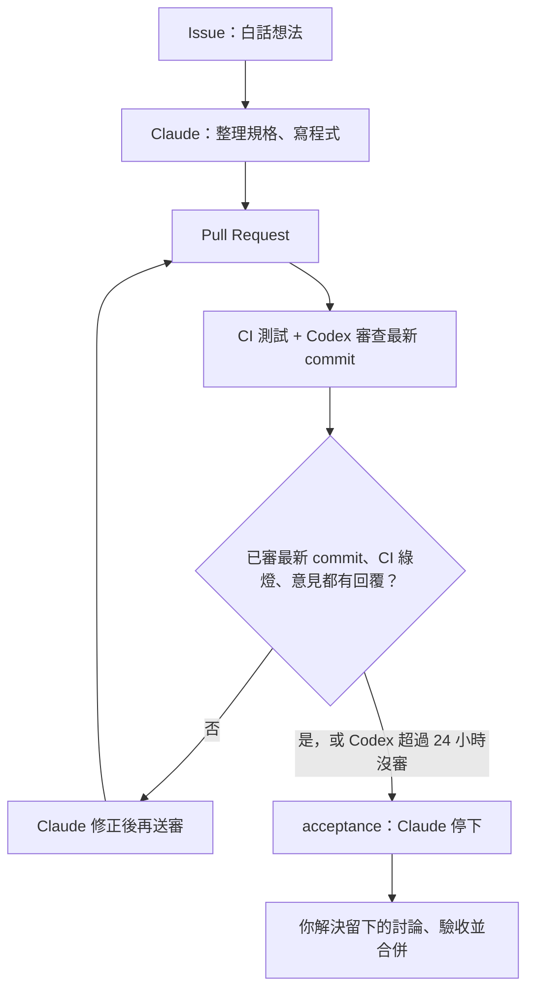

# claude-codex-lab

你用白話寫 GitHub Issue。Claude 每 4 小時做一件事：整理規格，或實作最舊的一個 `ready`。Codex 只做審查，GitHub Actions 跑測試。Codex 審過最新的 commit、CI 通過、意見都有回覆之後，Claude 停下等你驗收，由你合併到 `main`。

沒有人可以直接推上 `main`。

## 流程

1. 你開 Issue，用日常語言寫想法（表單會自動標上 `proposed`）。
2. Claude 把想法整理成規格與驗收條件。太大就拆成子 Issue，並請你加上 `ready`。這一步還不寫程式。
3. 你加上 `ready` 之後，若沒有尚未驗收的 PR，Claude 只做最舊的一個：拿掉 `ready`、標成 `in-progress`，在 `claude/issue-<編號>-<簡稱>` 上實作，開一張 PR。語言和框架由 Claude 決定，寫在 `docs/decisions/`。
4. CI 跑 `scripts/test.sh`，Codex 只提出嚴重問題（P0／P1）。
5. 有問題的話，Claude 修正並在該討論回覆 `[claude-fixed]`（Action 會把討論標成已解決）或 `[claude-declined]`（討論留著等你決定），再貼一次 `@codex review`。
6. Codex 已經審查最新的 commit、CI 綠燈、每則意見都有回覆之後，Claude 標上 `acceptance` 然後停下。超過 24 小時 Codex 仍沒審該 commit 時也會停下，並註明要你自己看那個 diff。你照驗收步驟看過，把還開著的討論解決，再合併。

產品方向不清楚、需要金鑰、會花錢、會刪資料、牽涉安全決策、同一種 CI 失敗修了三次，或不同意某個 P0 時，Claude 會標 `needs-human` 並停下來問你。技術選型不會問你。

## 標籤

| 標籤 | 意思 |
| --- | --- |
| `proposed` | 新想法，等 Claude 整理成規格 |
| `ready` | 規格確定，Claude 可以開始做 |
| `in-progress` | Claude 正在做或正在修 |
| `needs-human` | 需要你決定，AI 先停 |
| `acceptance` | 可以驗收了，等你合併 |
| `blocked` | 被其他 Issue 或外部因素卡住 |
| `P0` | 審查：嚴重問題（安全、資料遺失、壞掉、祕密進版控） |
| `P1` | 審查：明確的功能錯誤 |

規則全文在 [AGENTS.md](AGENTS.md)（英文，給 AI）。Claude 的操作步驟在 [CLAUDE.md](CLAUDE.md)。設定 Claude 排程與 Codex 審查見 [docs/SETUP.md](docs/SETUP.md)。
